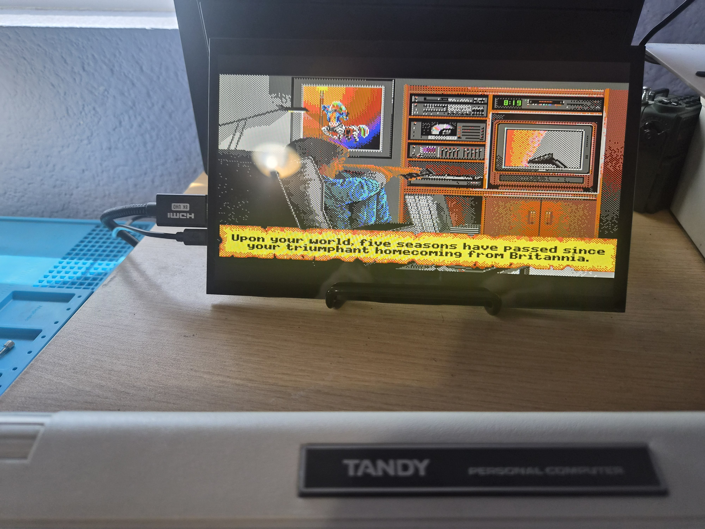
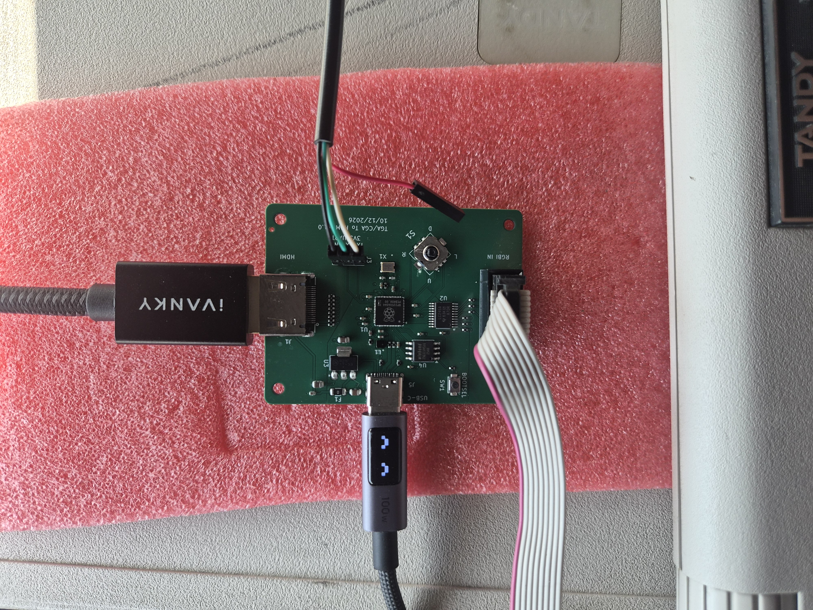
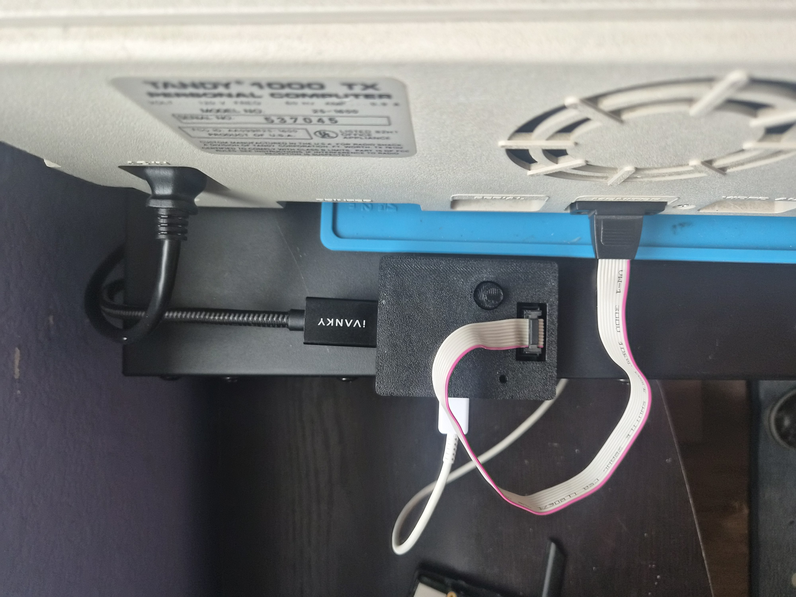
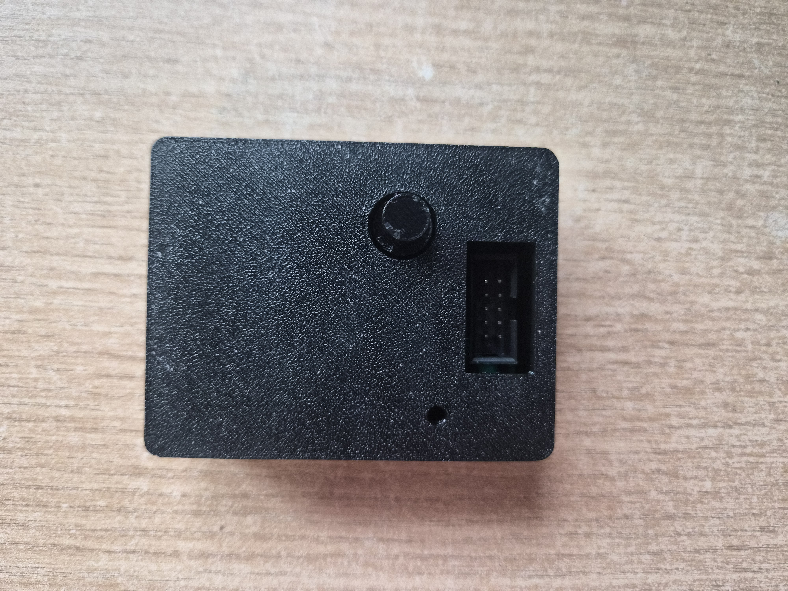

# RGBI_TO_DVI_CONVERTER

This is a converter for RGBI TTL video formats into DVI-D.  It uses an RP2350's PIO and HSTX to effiecently convert RGBI TTL signals into DVI compatible signal over and HDMI connector. It works with most HDMI monitors and TV's.

Currently supported modes are shown in the following table.

| System | Mode | Resolution | Colors | Notes |
|---|---|---|---|---|
| Tandy 1000 (Video I) | Text 40x25 | 320x200 | 16 | 8x8 character cell |
| Tandy 1000 (Video I) | Text 80x25 | 640x200 | 16 | |
| Tandy 1000 (Video I) | Graphics | 160x200 | 16 | |
| Tandy 1000 (Video I) | Graphics (CGA-compatible) | 320x200 | 4 | |
| Tandy 1000 (Video I) | Graphics | 320x200 | 16 | |
| Tandy 1000 (Video I) | Graphics (CGA-compatible) | 640x200 | 2 | |
| Tandy 1000 (Video I) | Graphics | 640x200 | 4 | |
| Tandy 1000 (Video II) | Graphics | 640x200 | 16 | Video II only (e.g. 1000 RL) |
| IBM CGA | Text 40x25 / 80x25 | 320x200 / 640x200 | 16 | Phase 2 |
| IBM CGA | Graphics | 320x200 | 4 | Phase 2 |
| IBM CGA | Graphics | 640x200 | 2 | Phase 2 |
| IBM PCjr | Graphics | 160x200, 320x200, 640x200 | 16 / 16 / 4 | Phase 2 |
| Plantronics ColorPlus | Graphics | 320x200, 640x200 | 16 / 4 | Phase 2 |
| Commodore 128 | 80-column (VDC) | 640x200 | 16 (RGBI) | Phase 2 |

Only TTL outputs are currently supported, there are no plans for composite outputs.  I may support EGA if I respin the board.

